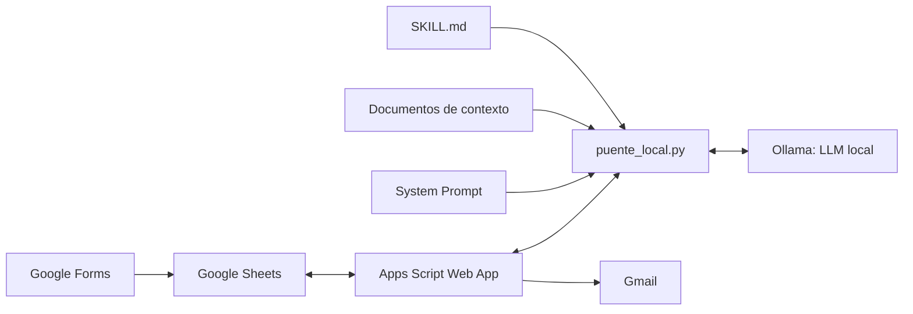

# Capítulo 8

# Automatización del asistente inteligente mediante Google Apps Script y Ollama

> **Práctica guiada de automatización:** [Sesión 4 — guía autónoma para Windows](../vol3_laboratorios/Guia_Autonoma_Sesion04_Windows_Paso_a_Paso.md). El flujo del ejemplo termina en estado **`ENVIADA`** y requiere comprobar tanto la hoja como la recepción del correo.

> **Versión operativa del taller (octubre de 2026).** Este capítulo utiliza una única implementación de referencia: [`scripts/Code.gs`](../scripts/Code.gs) y [`scripts/puente_local.py`](../scripts/puente_local.py). Los archivos completos son la fuente de código vigente; no es necesario reconstruirlos copiando fragmentos dispersos. Las explicaciones pedagógicas y los procedimientos de laboratorio se desarrollan aquí, mientras que el [Laboratorio 4](../vol3_laboratorios/Lab04.md) recoge las evidencias. Utilice únicamente información ficticia. **Las verificaciones de integración en un equipo real aún están pendientes.**

## 8.1 Arquitectura del flujo automatizado

### Objetivo
Comprender la distribución de responsabilidades entre Google Workspace, el puente Python y el modelo de lenguaje local.

### Componentes
| Componente | Responsabilidad |
|---|---|
| Google Forms | Captura de la consulta y datos ficticios del solicitante |
| Google Sheets | Registro de solicitudes, respuestas, fechas y estados |
| Apps Script (`Code.gs`) | API Web App para consultar, reservar y completar solicitudes; envío de correos mediante Gmail |
| Puente (`puente_local.py`) | Orquestación de solicitudes y llamadas a Ollama |
| Ollama | Ejecución del LLM local mediante `/api/chat` |
| `system_prompt.txt` | Instrucciones permanentes |
| `contexto/*.md` y `*.txt` | Documentos breves de referencia incorporados a la consulta |
| `skills/retroalimentacion-formativa/SKILL.md` | Procedimiento de respuesta en Markdown |



**Diferencia entre diseñar y automatizar:** Open WebUI permite configurar el asistente para probarlo interactivamente. Este puente llama directamente a Ollama y **no hereda automáticamente** las notas, las bases Knowledge ni las skills de Open WebUI. Los contenidos deben mantenerse en los archivos locales adecuados. Adjuntar archivos completos **no equivale a RAG**.

### Verificación
Explique cuál componente procesa el lenguaje, cuál gestiona estados y cuál realiza el envío de correo.

---

## 8.2 Diseño del proceso de integración

### Objetivo
Definir un flujo único y estados observables antes de activar la automatización.

### Estructura mínima de Google Sheets
Se utilizan ocho columnas, en el orden esperado por `Code.gs`:

| Columna | Campo | Ejemplo de prueba |
|---|---|---|
| A | Marca temporal | Fecha generada por Forms |
| B | Nombre | Estudiante Ficticio |
| C | Tipo de consulta | Académica |
| D | Consulta | ¿Cuál es el plazo de revisión del documento de ejemplo? |
| E | Correo electrónico | Cuenta de prueba autorizada |
| F | Estado | PENDIENTE |
| G | Respuesta IA | Inicialmente vacía |
| H | Fecha de procesamiento | Inicialmente vacía |

### Estados de trabajo
- **PENDIENTE:** solicitud aún no reservada.
- **PROCESANDO:** solicitud reservada por el puente para producir una respuesta.
- **ENVIADA:** la respuesta fue registrada y el procedimiento de envío por Gmail terminó sin error informado.
- **ERROR:** hubo una falla al finalizar una solicitud previamente reservada; revise el registro antes de reintentar.

En la versión actual, **GET no modifica estados**. La reserva solo ocurre cuando el puente envía `POST {"accion":"reclamar"}`; el cierre mediante `POST {"accion":"completar","fila":...,"respuesta":"..."}` registra el texto y realiza el envío.

### Restricciones didácticas
Se utilizarán nombres y consultas ficticios. Los participantes deben verificar que el Web App corresponde a su propio entorno y que la cuenta receptora está autorizada. El ejemplo no incluye autenticación específica puente-servidor; no es apto para uso institucional abierto.

---

## 8.3 Preparación del entorno de automatización

### Objetivo
Preparar las herramientas sin activar aún el envío de correos.

### Requisitos
1. Ollama instalado y un modelo descargado (capítulos 2 y 3).
2. Python operativo y dependencia `requests` instalada.
3. Formulario de Google vinculado a su hoja de cálculo (capítulo 7).
4. Permisos para editar y desplegar el proyecto de Apps Script asociado.
5. Carpeta `scripts/` descargada desde [el repositorio](https://github.com/juliopez/ia-local-integracion/tree/main/scripts), preservando la organización de archivos.

```text
scripts/
  puente_local.py
  Code.gs
  system_prompt.txt
  contexto/
    normativa_ejemplo.md
  skills/
    retroalimentacion-formativa/
      SKILL.md
```

En la terminal, desde la raíz del proyecto:

```bash
python -m pip install requests
```

Abra `puente_local.py` y ajuste **`MODELO_OLLAMA`** con el nombre exacto del modelo instalado. Ajuste **`URL_APPS_SCRIPT`** después de publicar el Web App.

**Precaución:** el código del repositorio contiene una URL de ejemplo; no asuma que corresponde a un servicio vigente ni autorizado para sus prácticas. El modelo `nombre-del-modelo` es un marcador y debe reemplazarse.

---

## 8.4 Implementación modular del proceso de integración

### Objetivo
Desplegar la versión única de Apps Script y comprender sus operaciones.

### Paso 1. Preparar la hoja
Vincule Google Forms a Sheets, compruebe el orden de las ocho columnas y coloque una consulta ficticia con estado `PENDIENTE`.

### Paso 2. Preparar Apps Script
Desde la hoja, abra **Extensiones → Apps Script**. Sustituya el contenido del archivo `Code.gs` por el archivo completo [`scripts/Code.gs`](../scripts/Code.gs) del repositorio.

No combine este código con versiones de capítulos o laboratorios anteriores. Compruebe que incluye `leerSolicitud(reservar)`, `doGet()` y `doPost(e)`. El código utiliza `LockService` para serializar las reservas; esto no garantiza recuperación automática tras fallos.

### Paso 3. Autorizar y desplegar
En Apps Script, utilice **Implementar → Nueva implementación → Aplicación web**. Configure los permisos adecuados para un ejercicio con una cuenta de prueba. Complete las autorizaciones que solicite Google; evite configuraciones públicas o el acceso de usuarios no autorizados. Copie la URL terminada en `/exec` e introdúzcala en `URL_APPS_SCRIPT`.

**Importante:** después de modificar `Code.gs`, actualice la versión del despliegue. Editar el código no actualiza automáticamente una URL `/exec` ya publicada.

### Paso 4. Comprobar el contrato de API
| Operación | Método | Efecto |
|---|---|---|
| Observar pendiente | GET | Devuelve una solicitud sin modificar su estado |
| Reservar pendiente | POST `accion=reclamar` | Cambia una solicitud a `PROCESANDO`, con bloqueo |
| Completar reserva | POST `accion=completar` | Guarda respuesta, intenta enviar correo y marca `ENVIADA` |

El envío de Gmail y la actualización de Sheets **no son una transacción atómica**; ante errores, compruebe el estado y el correo enviado antes de repetir.

---

## 8.5 Lectura de solicitudes desde Google Sheets — sesión 3

### Objetivo
Leer desde Python una solicitud almacenada en Sheets, sin procesarla ni modificarla.

### Procedimiento
1. Confirme que el código vigente `Code.gs` está desplegado como Web App.
2. Registre una consulta ficticia en Forms y establezca `PENDIENTE` en la columna F, si su configuración no lo asigna automáticamente.
3. Verifique `URL_APPS_SCRIPT` en `puente_local.py`.
4. Ejecute desde la raíz:

```bash
python scripts/puente_local.py --modo lectura
```

5. Observe los campos impresos en la terminal. Regrese a Sheets y compruebe que **la columna F continúa indicando `PENDIENTE`**.

### Resultado esperado
El modo `lectura` realiza GET, no consulta Ollama, no escribe en Sheets y no envía correos.

### Si falla
- Revise el despliegue actual de Apps Script y sus permisos.
- Compruebe la URL y el orden de columnas.
- Si una solicitud pasa a `PROCESANDO` al leer, se está utilizando **un despliegue antiguo**, no `Code.gs` vigente.

**Evidencia de la sesión 3:** captura de la consola con la consulta ficticia y de la hoja con su estado `PENDIENTE`.

---

## 8.6 Comunicación con el asistente mediante un puente local — sesión 4

### Objetivo
Validar el modelo, el System Prompt, la skill y el contexto documental **sin acceder a Google Workspace**.

### Procedimiento
1. Compruebe que Ollama está ejecutándose y que `MODELO_OLLAMA` coincide con un modelo instalado.
2. Revise los siguientes archivos:
   - `system_prompt.txt`: rol, objetivos y restricciones.
   - `contexto/normativa_ejemplo.md`: texto ficticio de referencia.
   - `skills/retroalimentacion-formativa/SKILL.md`: procedimiento en Markdown.
3. Ejecute:

```bash
python scripts/puente_local.py --modo prueba
```

4. Compare la respuesta con `normativa_ejemplo.md`. Si el archivo se modifica, repita el ejercicio. Si modifica `system_prompt.txt` durante el modo completo continuo, reinicie el proceso para volver a cargarlo.

### Resultado esperado
El puente solicita a Ollama una respuesta a una consulta ficticia; el mensaje incluye contexto documental e instrucciones locales. **No consulta Sheets ni envía correos.**

### Limitaciones
La skill se interpreta como texto instructivo, **no ejecuta código** ni concede acceso a herramientas. El puente incorpora documentos completos con límites de caracteres; no implementa indexación, búsqueda semántica ni RAG. La calidad de las respuestas depende del modelo seleccionado y debe comprobarse.

---

## 8.7 Envío automático de respuestas y actualización del estado — sesión 4

### Objetivo
Realizar una operación completa y controlada desde una solicitud de prueba.

### Procedimiento
1. Use únicamente una cuenta destinataria de prueba autorizada.
2. Confirme que el Apps Script **vigente** está desplegado y que la hoja contiene una solicitud ficticia con estado `PENDIENTE`.
3. Confirme que el modo `prueba` devuelve una respuesta útil antes de activar el envío.
4. Ejecute **un solo ciclo**:

```bash
python scripts/puente_local.py --modo completo --una-vez
```

5. Compruebe esta secuencia:
   - Apps Script reserva la solicitud con `accion=reclamar`, cambiándola a `PROCESANDO`.
   - Python genera la respuesta mediante Ollama.
   - Python devuelve la respuesta con `accion=completar`.
   - Apps Script escribe las columnas G y H y solicita el envío a Gmail.
   - La hoja termina en estado `ENVIADA` si no se reportó un error.

### Si falla
No cambie automáticamente una fila `PROCESANDO` o `ERROR` a `PENDIENTE`. Si la conexión se interrumpe después del envío, podría producirse un correo duplicado al reintentar. Revise la hoja y la carpeta de enviados antes de realizar una recuperación manual supervisada.

La implementación se utiliza como **prototipo pedagógico**: no garantiza entrega efectiva en el buzón del destinatario, reintentos seguros ni autenticación independiente del despliegue.

---

## 8.8 Validación integral del servicio inteligente

### Objetivo
Documentar evidencia de cada fase y preparar el proyecto para la posterior optimización (capítulo 6 y Laboratorio 3).

### Lista de comprobación
| Caso de prueba | Evidencia | Criterio |
|---|---|---|
| Captura | Forms → Sheets | Nueva fila registrada |
| Lectura no destructiva | `--modo lectura` | La fila sigue `PENDIENTE` |
| Respuesta local | `--modo prueba` | La respuesta utiliza el contexto disponible |
| Falta de información | Consulta no documentada | El asistente reconoce los límites |
| Procesamiento completo | `--modo completo --una-vez` | Estado final `ENVIADA`, columnas G y H registradas |
| Comunicación | Gmail de prueba | Comprobar envío y recepción |
| Error o interrupción | Revisión de estados | Se identifica el caso sin reintento ciego |

### Pruebas automatizadas sin instalación de Ollama
Desde la raíz del repositorio:

```bash
python -m unittest discover -s scripts/tests -v
```

Los tests de `scripts/tests/test_puente_local.py` simulan las comunicaciones externas. Verifican que los modos no realicen operaciones indebidas, pero **no prueban el despliegue real de Apps Script ni la calidad del modelo**. Ejecute estas pruebas antes de la comprobación funcional en un equipo.

### Entregables sugeridos
- Carpeta local estandarizada con `system_prompt.txt`, documento ficticio y `SKILL.md`.
- Evidencia de lectura sin modificación de estado (sesión 3).
- Evidencia de prueba local y de procesamiento completo (sesión 4).
- Breve bitácora con problemas observados, decisiones y mejoras pendientes.

### Seguridad y limitaciones
Este ejemplo no implementa autenticación dedicada entre Python y Web App, ni recuperación automática segura de reservas, ni idempotencia de envíos. **No publique el Web App con acceso abierto ni procese datos reales.** Antes de reutilizarlo en una institución se requiere un diseño de seguridad y fiabilidad más robusto.

---

## Resumen del capítulo

En este capítulo se distinguieron tres operaciones: **leer**, **probar** y **procesar**. La separación protege las solicitudes durante la sesión 3 y permite que la sesión 4 utilice el mismo puente junto a un modelo local, archivos de contexto y una skill. La evidencia de ejecución real se completará cuando se validen los servicios en el equipo de referencia.

**Capítulo siguiente:** [Capítulo 9 — Operación y mantenimiento del servicio inteligente](cap09_mt.md).
