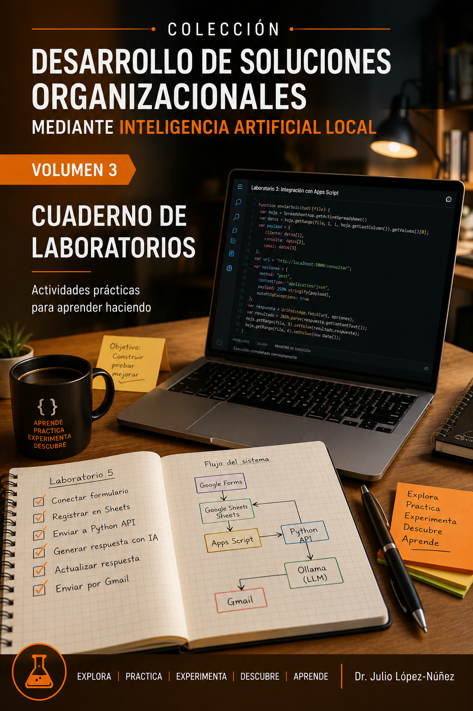

  

# Volumen 3 — Cuaderno de Laboratorios

Seis laboratorios originales, con guías complementarias para la ruta intensiva de cinco sesiones.

## Contenidos

- [Laboratorio 1](Lab01.md)
- [Laboratorio 2](Lab02.md)
- [Laboratorio 3](Lab03.md)
- [Laboratorio 4](Lab04.md)
- [Laboratorio 5](Lab05.md)
- [Laboratorio 6](Lab06.md)

Para el taller de 10 horas, siga la [ruta de cinco sesiones](../EMPEZAR_AQUI.md): Lab01 → Lab02 → Lab04 (sesiones 3 y 4) → Lab03. Los laboratorios 5 y 6 se conservan como profundización.

[Volver a la ruta de aprendizaje](../EMPEZAR_AQUI.md) · [Biblioteca de cinco volúmenes](https://juliopez.github.io/ia-local-integracion/biblioteca.html)
