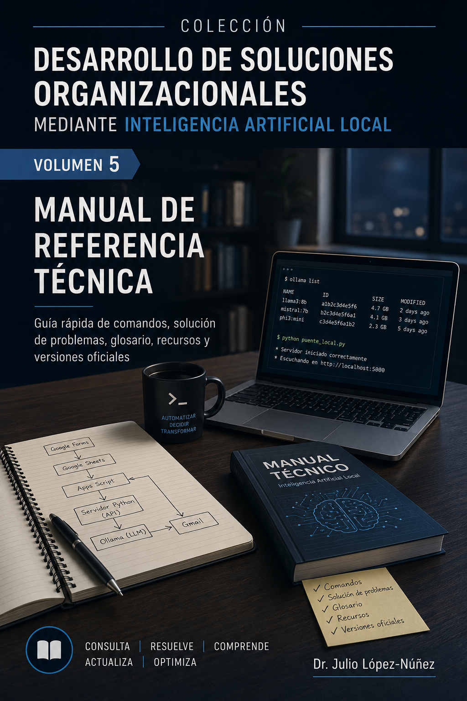

  

# Volumen 5 — Manual de Referencia Técnica

Código, comandos, solución de problemas, glosario, recursos complementarios y versiones de software.

## Contenidos

- [Capítulo 1 — Introducción y arquitectura](cap01_mr.md)
- [Capítulo 2 — Código fuente completo](cap02_mr.md)
- [Capítulo 3 — Guía rápida de comandos](cap03_mr.md)
- [Capítulo 4 — Solución de problemas](cap04_mr.md)
- [Capítulo 5 — Glosario técnico](cap05_mr.md)
- [Capítulo 6 — Recursos complementarios](cap06_mr.md)
- [Capítulo 7 — Versiones de software utilizadas](cap07_mr.md)

Para complementar el estudio de los cinco volúmenes, consulte la colección de [Recursos interactivos y actividades de apoyo](../RECURSOS_INTERACTIVOS.md), que reúne herramientas de exploración y actividades didácticas vinculadas con los contenidos de la obra.

[Volver a la ruta de aprendizaje](../EMPEZAR_AQUI.md) · [Biblioteca de cinco volúmenes](https://juliopez.github.io/ia-local-integracion/biblioteca.html)
